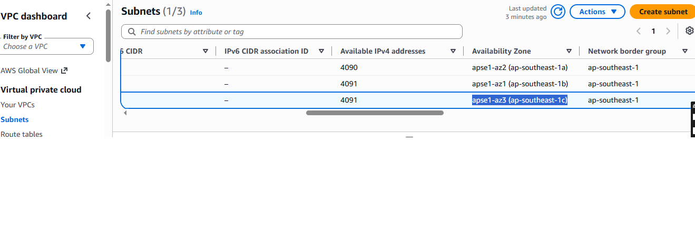
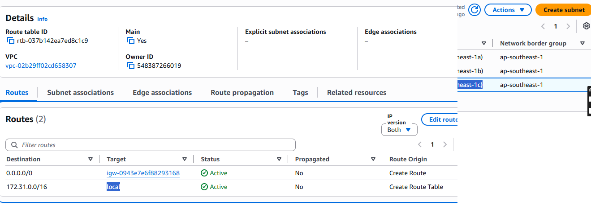
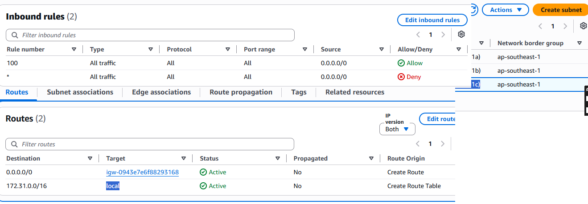
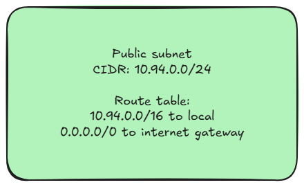

# Assignment 2 Submission

<!--
How to use this template:

1. Copy this file to submissions/assignment-2/<your-github-username>/submission.md
2. Replace every answer placeholder with your own answer. Delete the angle brackets too.
3. Save your four images in the same folder, with the exact file names below.
4. Do not write your full name or your student number in this file.
-->

## About me

- GitHub username: JohnJhayAdriano
- Section: IV-BCSAD
- IAM user name that I signed in with: bcsad-g01
- X: 94

---

## Part A. Explore

### A1. The VPC

Default VPC IPv4 CIDR:

172.31.0.0/16

Number of addresses in that CIDR:

65536

### A2. The subnets

| Availability Zone | IPv4 CIDR |
| --- | --- |
| apse1-az2 (ap-southeast-1a) | 4090 |
| apse1-az1 (ap-southeast-1b) | 4091 |
| apse1-az3 (ap-southeast-1c) | 4091 |

Screenshot 1. Save it as `screenshot-1-subnets.png` in your folder. The image line below shows it.

### A3. Available addresses

Available IPv4 addresses in each subnet:

4090, 4091

Why is the number lower than 4,096?

AWS reserves 5 IP addresses in every subnet CIDR block (the network address, the VPC router, the DNS server, a reserved IP for future use, and the broadcast address).

What uses the missing address in the subnet with the lowest number?

An active AWS resource running inside that specific subnet (such as an active EC2 instance or a NAT gateway) takes up an extra private IP address.

### A4. The route table

| Destination | Target |
| --- | --- |
| 0.0.0.0/0 | igw-0943e7e6f88293168 |
| 172.31.0.0/16 | 	
local |

Screenshot 2. Save it as `screenshot-2-routes.png` in your folder. The image line below shows it.

### A5. Public or private

Are the default subnets public or private? Which route proves it?

They are public subnets. The route 0.0.0.0/0 pointing to the internet gateway (igw-...) allows communication with the public internet.

### A6. The internet gateway

State of the internet gateway:

Attached

What happens to the default subnets if the gateway is detached?

Instances in the default subnets will immediately lose all direct inbound and outbound connectivity to the public internet.

### A7. NAT gateways

Number of NAT gateways:

0

Can a server in a new private subnet download updates? Why?

No, because a private subnet has no route to a NAT gateway or internet gateway, and without a NAT gateway, it cannot route outbound internet traffic securely while remaining hidden from inbound traffic.

### A8. The network ACL

| Rule number | Source | Allow or Deny |
| --- | --- | --- |
| 100 | 0.0.0.0/0 | Allow |
| * | 0.0.0.0/0 | Deny |

How is a network ACL different from a security group?

A Network ACL operates at the subnet level and is stateless (meaning return traffic must be explicitly allowed by rules). A Security Group operates at the instance level and is stateful (meaning return traffic is automatically allowed)

Screenshot 3. Save it as `screenshot-3-network-acl.png` in your folder. The image line below shows it.

### A9. The default security group

Inbound rule (type and source):

All traffic, sg-0c5b6d4081cf0a534 / default

Which resources can send traffic to an instance that uses it?

Only other resources (instances) that are assigned to this exact same default security group

---

## Part B. Prepare

### B1. Plan two subnets

- Public subnet CIDR: 10.94.0.0/24
- Private subnet CIDR: 10.94.1.0/24

### B2. Route tables

Route table of the public subnet:

| Destination | Target |
| --- | --- |
| 10.94.0.0/16 | local |
| 0.0.0.0/0 | internet gateway |

Route table of the private subnet:

| Destination | Target |
| --- | --- |
| 10.94.0.0/16 | local |

### B3. My VPC diagram

Tool used (Excalidraw, draw.io, Lucidchart, or paper):

Excalidraw

Save your diagram as `vpc-diagram.png` in your folder. The image line below shows it.

### B4. Predict a change

Can you still open the web page from your laptop? Why?

No. Removing the 0.0.0.0/0 route removes the path to the internet gateway, so traffic from the internet cannot reach the instance.

Can the instance still reach another instance in the VPC? Why?

Yes. Local communication within the VPC is handled by the local route (10.X.0.0/16), which remains intact.

### B5. Place a database

Which subnet gets the database? Why?

The private subnet. Databases handle sensitive data and should never be exposed directly to the public internet. Placing it in a private subnet protects it behind barriers while allowing backend communication from application servers.

### B6. My question about VPCs

What is your question, and what made you think of it?

What happens to active TCP connections if an Elastic IP attached to a NAT Gateway is suddenly changed or disassociated? thought of this while wondering how long-lived database queries or user sessions handle underlying network infrastructure updates in AWS production environments.
