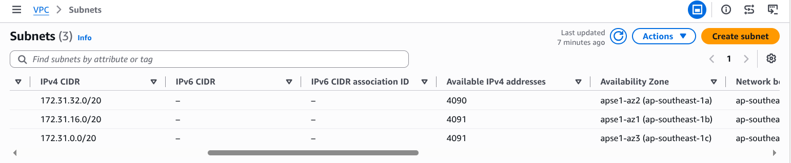
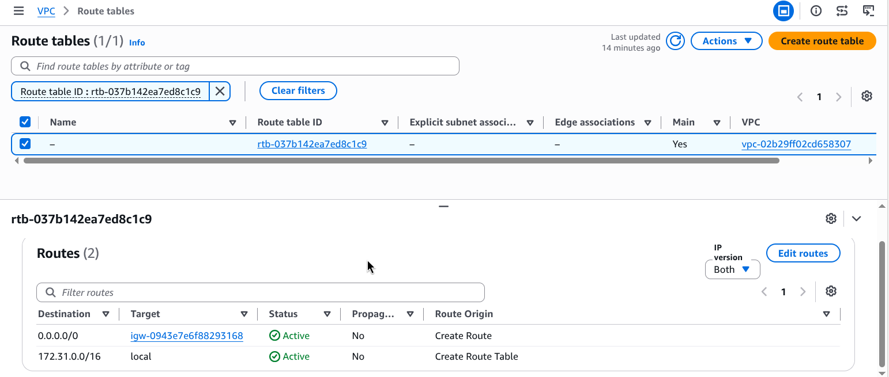
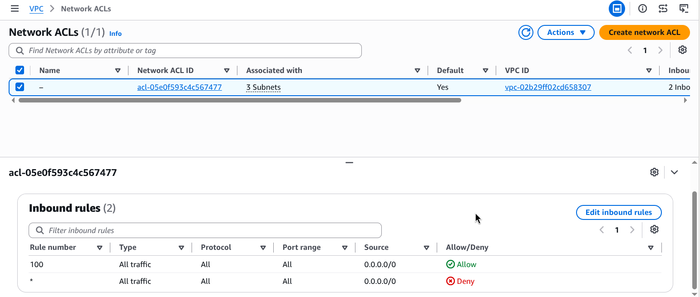
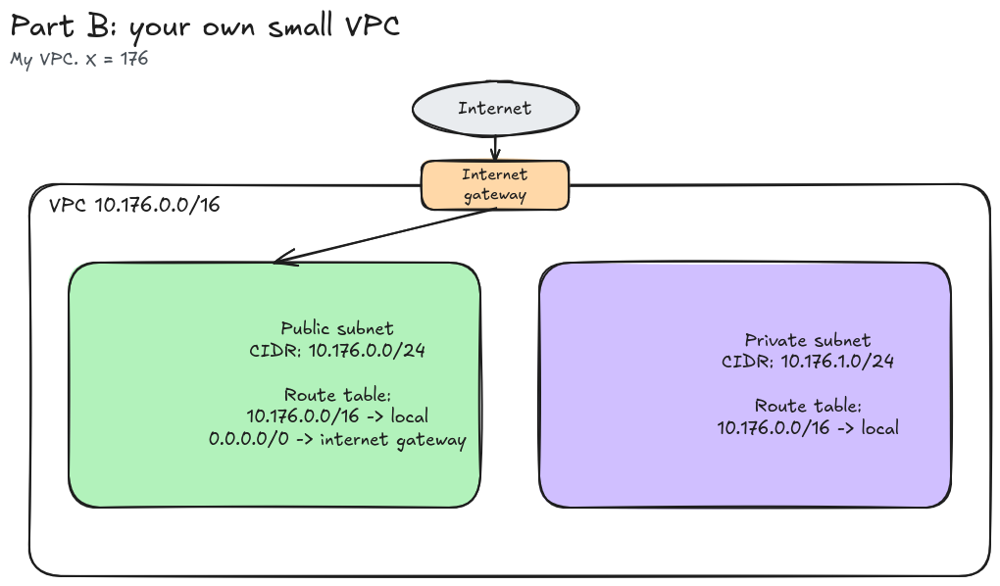

# Assignment 2 Submission

<!--
How to use this template:

1. Copy this file to submissions/assignment-2/<your-github-username>/submission.md
2. Replace every answer placeholder with your own answer. Delete the angle brackets too.
3. Save your four images in the same folder, with the exact file names below.
4. Do not write your full name or your student number in this file.
-->

## About me

- GitHub username: MeinardEdrei
- Section: IV-BCSAD
- IAM user name that I signed in with: bcsad-g05
- X: 176

---

## Part A. Explore

### A1. The VPC

Default VPC IPv4 CIDR:

`172.31.0.0/16`

Number of addresses in that CIDR:

65,536

### A2. The subnets

| Availability Zone | IPv4 CIDR |
| --- | --- |
| ap-southeast-1a | `172.31.32.0/20` |
| ap-southeast-1b | `172.31.16.0/20` |
| ap-southeast-1c | `172.31.0.0/20` |

Screenshot 1. Save it as `screenshot-1-subnets.png` in your folder. The image line below shows it.

### A3. Available addresses

Available IPv4 addresses in each subnet:

- ap-southeast-1a (`172.31.32.0/20`): 4,090
- ap-southeast-1b (`172.31.16.0/20`): 4,091
- ap-southeast-1c (`172.31.0.0/20`): 4,091

Why is the number lower than 4,096?

A /20 has 4,096 addresses. AWS keeps 5 of them in every subnet for itself (the first four and the last one). So 4,096 - 5 = 4,091 can be used.

What uses the missing address in the subnet with the lowest number?

The lowest number is 4,090, in ap-southeast-1a. It is one less than the other two, so one more address is taken. A network interface uses it, for example from an instance. A stopped instance still holds its address too. I only looked at the subnet list, so I don't know which exact resource it is.

### A4. The route table

| Destination | Target |
| --- | --- |
| `0.0.0.0/0` | `igw-...` (internet gateway) |
| `172.31.0.0/16` | `local` |

Screenshot 2. Save it as `screenshot-2-routes.png` in your folder. The image line below shows it.

### A5. Public or private

Are the default subnets public or private? Which route proves it?

Public. The route `0.0.0.0/0` points to an internet gateway (`igw-...`). That is what makes a subnet public.

### A6. The internet gateway

State of the internet gateway:

Attached

What happens to the default subnets if the gateway is detached?

They lose their way to the internet. The `0.0.0.0/0` route would point to nothing, so traffic to and from the internet stops. The subnets can still talk to each other through the local route.

### A7. NAT gateways

Number of NAT gateways:

0

Can a server in a new private subnet download updates? Why?

No. A private subnet has no route to the internet gateway, and there is no NAT gateway that could give it a way out. So it can't start a connection to the internet to download updates.

### A8. The network ACL

| Rule number | Source | Allow or Deny |
| --- | --- | --- |
| 100 | `0.0.0.0/0` | Allow |
| `*` | `0.0.0.0/0` | Deny |

How is a network ACL different from a security group?

A network ACL works on a whole subnet, and it has both allow and deny rules. A security group works on one resource, like an instance, and it has allow rules only. A network ACL is also stateless, so replies need their own rule. A security group is stateful.

Screenshot 3. Save it as `screenshot-3-network-acl.png` in your folder. The image line below shows it.

### A9. The default security group

Inbound rule (type and source):

Type: All traffic. Source: `sg-... / default` (the default security group itself).

Which resources can send traffic to an instance that uses it?

Only resources that use this same default security group. The source is the group itself, so anything outside the group, like my laptop on the internet, is blocked.

---

## Part B. Prepare

### B1. Plan two subnets

- Public subnet CIDR: `10.176.0.0/24`
- Private subnet CIDR: `10.176.1.0/24`

### B2. Route tables

Route table of the public subnet:

| Destination | Target |
| --- | --- |
| `10.176.0.0/16` | local |
| `0.0.0.0/0` | internet gateway |

Route table of the private subnet:

| Destination | Target |
| --- | --- |
| `10.176.0.0/16` | local |

### B3. My VPC diagram

Tool used (Excalidraw, draw.io, Lucidchart, or paper):

Excalidraw

Save your diagram as `vpc-diagram.png` in your folder. The image line below shows it.

### B4. Predict a change

Can you still open the web page from your laptop? Why?

No. The `0.0.0.0/0` route is the one that points to the internet gateway. Without it, the subnet has no path to the internet, so the traffic from my laptop and the reply can't get through. The subnet turns private.

Can the instance still reach another instance in the VPC? Why?

Yes. The local route is a different route and I did not delete it. It still connects all the subnets inside the VPC.

### B5. Place a database

Which subnet gets the database? Why?

The private subnet, `10.176.1.0/24`. It has no route to the internet gateway, so nobody on the internet can reach the database directly. Only things inside the VPC can reach it through the local route.

### B6. My question about VPCs

What is your question, and what made you think of it?

If the database sits in a private subnet with no NAT gateway, how does it get security updates? I thought of this because of A7. A private subnet with no NAT gateway can't download anything from the internet.
