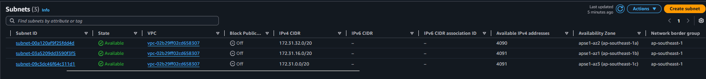
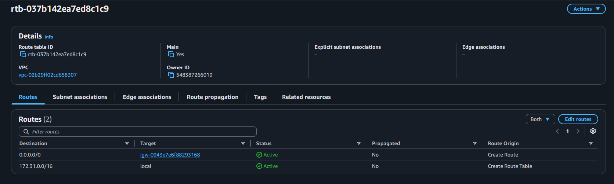
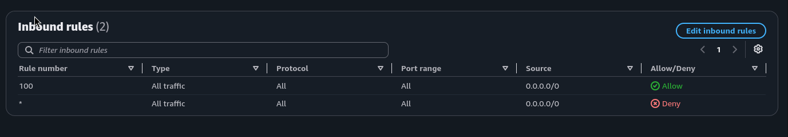
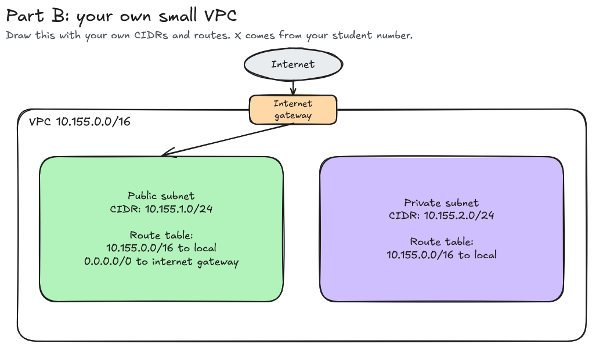

# Assignment 2 Submission

<!--
How to use this template:

1. Copy this file to submissions/assignment-2/<your-github-username>/submission.md
2. Replace every answer placeholder with your own answer. Delete the angle brackets too.
3. Save your four images in the same folder, with the exact file names below.
4. Do not write your full name or your student number in this file.
-->

## About me

- GitHub username: justinecasiano
- Section: IV-BCSAD
- IAM user name that I signed in with: bcsad-g02
- X: `155`

---

## Part A. Explore

### A1. The VPC

Default VPC IPv4 CIDR:

`172.31.0.0/16`

Number of addresses in that CIDR:

`65,536`

### A2. The subnets

| Availability Zone | IPv4 CIDR        |
| ----------------- | ---------------- |
| `ap-southeast-1a` | `172.31.32.0/20` |
| `ap-southeast-1b` | `172.31.16.0/20` |
| `ap-southeast-1c` | `172.31.0.0/20`  |

Screenshot 1. Save it as `screenshot-1-subnets.png` in your folder. The image line below shows it.

### A3. Available addresses

Available IPv4 addresses in each subnet:

`ap-southeast-1a` `4,090`, `ap-southeast-1b` `4,091`, `ap-southeast-1c` `4,091`.

Why is the number lower than 4,096?

`AWS reserves 5 IP addresses in every subnet for internal networking tasks, leaving 4,091 usable addresses.`

What uses the missing address in the subnet with the lowest number?

`An active AWS resource inside that subnet such as an EC2 instance, a NAT Gateway, or a load balancer, is currently assigned to that IP address.`

### A4. The route table

| Destination     | Target                  |
| --------------- | ----------------------- |
| `0.0.0.0/0`     | `igw-0943e7e6f88293168` |
| `172.31.0.0/16` | `local`                 |

Screenshot 2. Save it as `screenshot-2-routes.png` in your folder. The image line below shows it.

### A5. Public or private

Are the default subnets public or private? Which route proves it?

`They are public. The default route with destination 0.0.0.0/0 targeting an Internet Gateway (igw-0943e7e6f88293168).`

### A6. The internet gateway

State of the internet gateway:

`Attached`

What happens to the default subnets if the gateway is detached?

`The route targeting the gateway enters a Blackhole state, the subnets effectively become private, and instances inside them immediately lose all direct internet access (both inbound and outbound).`

### A7. NAT gateways

Number of NAT gateways:

`0`

Can a server in a new private subnet download updates? Why?

`No. A private subnet has no route to an Internet Gateway, and without an active NAT Gateway configured in its route table, outbound packets to the internet have no valid target and are dropped.`

### A8. The network ACL

| Rule number | Source      | Allow or Deny |
| ----------- | ----------- | ------------- |
| 100         | `0.0.0.0/0` | Allow         |
| `*`         | `0.0.0.0/0` | Deny          |

How is a network ACL different from a security group?

`A Network ACL operates at the subnet level, is stateless (return traffic must be explicitly permitted), evaluates rules in numerical order, and supports both Allow and Deny rules; a Security Group operates at the instance level, is stateful, evaluates all rules together, and supports Allow rules only.`

Screenshot 3. Save it as `screenshot-3-network-acl.png` in your folder. The image line below shows it.

### A9. The default security group

Inbound rule (type and source):

Type: `All traffic`, Source: `sg-0c5b6d4081cf0a534 (the default security group itself)`

Which resources can send traffic to an instance that uses it?

`Only other AWS resources (such as EC2 instances or network interfaces) within the same VPC that are explicitly assigned to that exact same default security group.`

---

## Part B. Prepare

### B1. Plan two subnets

- Public subnet CIDR: `10.155.1.0/24`
- Private subnet CIDR: `10.155.2.0/24`

### B2. Route tables

Route table of the public subnet:

| Destination | Target |
| --- | --- |
| `10.155.0.0/16` | local |
| `0.0.0.0/0` | `internet gateway` |

Route table of the private subnet:

| Destination | Target |
| --- | --- |
| `10.155.0.0/16`| `local` |

### B3. My VPC diagram

Tool used (Excalidraw, draw.io, Lucidchart, or paper):

`Excalidraw`

Save your diagram as `vpc-diagram.png` in your folder. The image line below shows it.

### B4. Predict a change

Can you still open the web page from your laptop? Why?

`No. Detaching the Internet Gateway removes the path to the outside world. Traffic from your laptop cannot route into the VPC, and the instance has no route to send the response back across the internet.`

Can the instance still reach another instance in the VPC? Why?

`Yes. All subnets inside the VPC still use the internal local route targeting the VPC CIDR block.`

### B5. Place a database

Which subnet gets the database? Why?

`The private subnet (10.155.2.0/24). Databases store sensitive information and must be isolated from direct internet access; placing the database in a private subnet allows internal backend servers to reach it via the VPC's local route while blocking unwanted connections from the outside world.`

### B6. My question about VPCs

What is your question, and what made you think of it?

Question: `If an EC2 instance in a private subnet must securely access an AWS service like Amazon S3 without routing traffic out to the public internet or paying for a NAT Gateway, how is that direct connection configured?`

What made me think of it: `Seeing that databases and private instances have no route to an Internet Gateway made me wonder how isolated backend workloads interact with managed AWS cloud services without opening outbound internet paths.`
