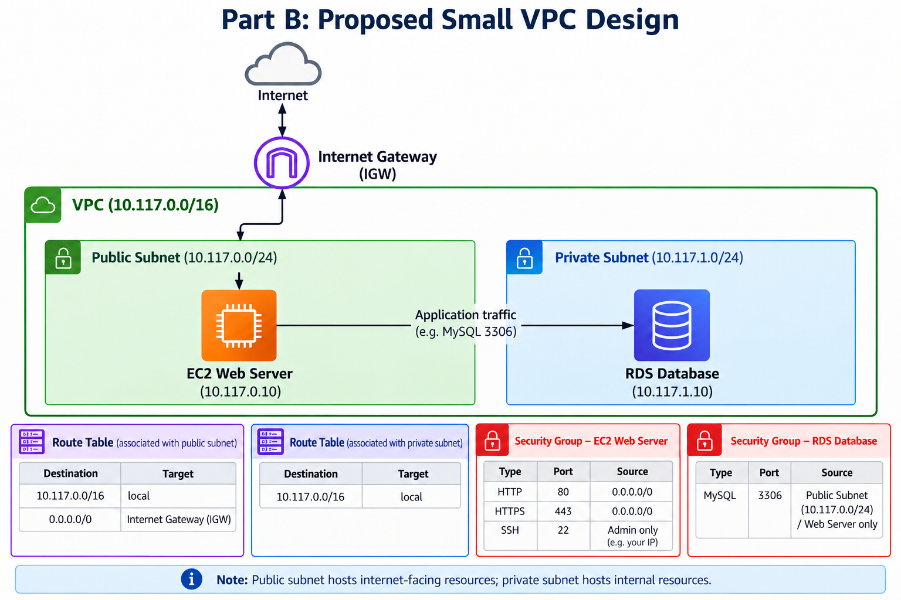
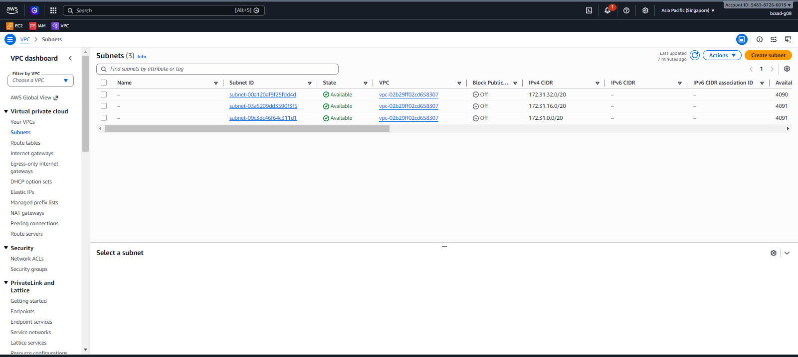
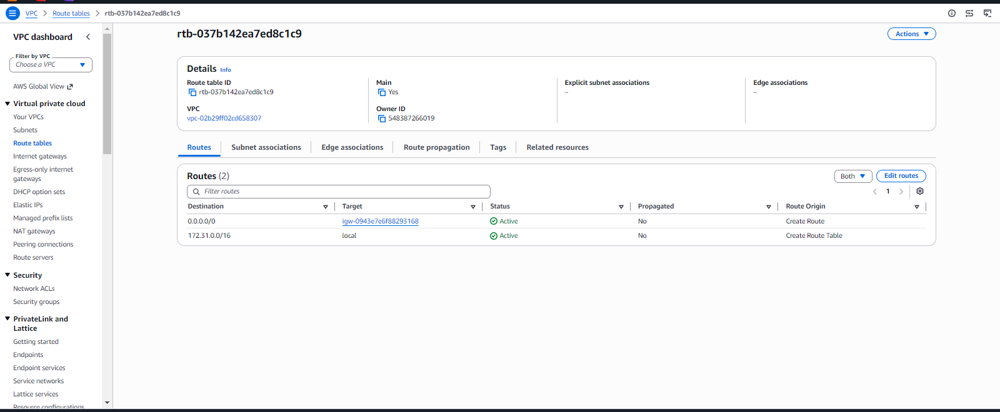
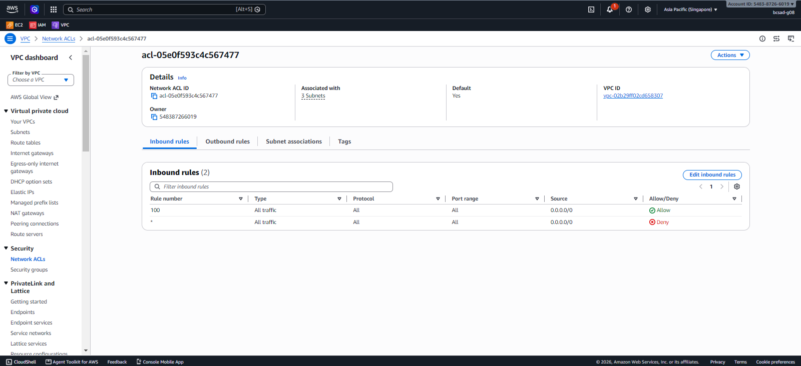

# Assignment #2: Explore a VPC

## About me

- GitHub username: `marionnn10`
- IAM user name that I signed in with: Lab group IAM user
- AWS Region: Singapore (`ap-southeast-1`)
- X: 117

---

# Part A. Explore

## A1. The VPC

Default VPC IPv4 CIDR:

`172.31.0.0/16`

Number of IPv4 addresses in that CIDR:

65,536

---

## A2. The subnets

The default VPC contains three default subnets.

| Availability Zone | IPv4 CIDR |
|---|---|
| `ap-southeast-1a` | `172.31.32.0/20` |
| `ap-southeast-1b` | `172.31.16.0/20` |
| `ap-southeast-1c` | `172.31.0.0/20` |

---

## A3. Available IPv4 addresses

| Subnet CIDR | Available IPv4 addresses |
|---|---:|
| `172.31.32.0/20` | 4,090 |
| `172.31.16.0/20` | 4,091 |
| `172.31.0.0/20` | 4,091 |

Each `/20` subnet contains 4,096 IPv4 addresses. AWS reserves five addresses in every subnet, so an otherwise unused subnet has 4,091 available addresses.

The `172.31.32.0/20` subnet has 4,090 available addresses, one fewer than the other two. This means one additional address is allocated to a resource or network interface in that subnet. The screenshot does not identify the exact resource; check the EC2 instance's subnet/network interface in the AWS console before naming it specifically.

---

## A4. The route table

Routes in the default VPC route table:

| Destination | Target |
|---|---|
| `172.31.0.0/16` | `local` |
| `0.0.0.0/0` | `igw-0943e7e688293168` (Internet Gateway) |

The local route allows resources in the VPC to communicate with each other. The `0.0.0.0/0` route sends traffic for destinations outside the VPC to the Internet Gateway.

---

## A5. Public or private subnets

The default subnets are public because their route table includes `0.0.0.0/0` pointing to the Internet Gateway.

---

## A6. The Internet Gateway

State of the Internet Gateway: **Attached**.

If the Internet Gateway is detached, the default subnets lose their path to the internet through the `0.0.0.0/0` route. Resources can still communicate inside the VPC because the local route remains.

---

## A7. NAT gateways

Number of NAT gateways: **0**.

A server in a new private subnet cannot download updates from the internet using the current setup because there is no NAT Gateway. For outbound internet access, the private subnet would need a route such as `0.0.0.0/0` pointing to a NAT Gateway.

---

## A8. The network ACL

Inbound rules:

| Rule number | Type | Source | Allow/Deny |
|---|---|---|---|
| 100 | All traffic | `0.0.0.0/0` | Allow |
| `*` | All traffic | `0.0.0.0/0` | Deny |

A Network ACL applies to a subnet and is stateless, so inbound and outbound traffic are evaluated separately. A Security Group applies to network interfaces/resources and is stateful, so return traffic is automatically allowed. Network ACLs can allow or deny traffic, while Security Groups contain allow rules.

---

## A9. The default security group

Inbound rule: **All traffic from the same default Security Group**.

Only resources that use that same Security Group can send inbound traffic allowed by this rule. Other sources are not allowed by this inbound rule.

---

# Part B. Prepare

## B1. Plan two subnets

My value is:

`X = 100 + 17 = 117`

VPC CIDR:

`10.117.0.0/16`

Public subnet CIDR (the first `/24` in the VPC range):

`10.117.0.0/24`

Private subnet CIDR (the next `/24` after the public subnet):

`10.117.1.0/24`

---

## B2. Route tables

### Public subnet route table

| Destination | Target |
|---|---|
| `10.117.0.0/16` | `local` |
| `0.0.0.0/0` | Internet Gateway |

### Private subnet route table

| Destination | Target |
|---|---|
| `10.117.0.0/16` | `local` |

The public subnet has a default route to the Internet Gateway. The private subnet has only the local route and no direct default route to the Internet Gateway or NAT Gateway.

---

## B3. My VPC diagram

Tool used: **Excalidraw**.

The diagram shows the VPC CIDR, both subnet CIDRs, the Internet Gateway connected to the public subnet, and the route table for each subnet.

---

## B4. Predict a change

**Can you still open the web page from your laptop? Why?**

No. If the `0.0.0.0/0` route is deleted from the default route table, the instance no longer has a route through the Internet Gateway for internet-bound traffic. Having a public IPv4 address alone does not provide a working route to the internet.

**Can the instance still reach another instance in the same VPC? Why?**

Yes. The local route for `172.31.0.0/16` remains in the default VPC route table, so instances in that VPC can still communicate if their Security Group and Network ACL rules allow the traffic.

---

## B5. Place a database

The database should be placed in the private subnet, `10.117.1.0/24`. Its route table has no direct route to the Internet Gateway, so the database is not directly exposed to the internet.

---

## B6. My question about VPCs

**What is your question, and what made you think of it?**

Can two VPCs in the same AWS account communicate with each other securely?

I thought of this because multiple VPCs can exist in one AWS account, and some applications may need to communicate across separate networks.

---

# Evidence / Screenshots

## Screenshot 1: Subnets

## Screenshot 2: Routes

## Screenshot 3: Network ACL

