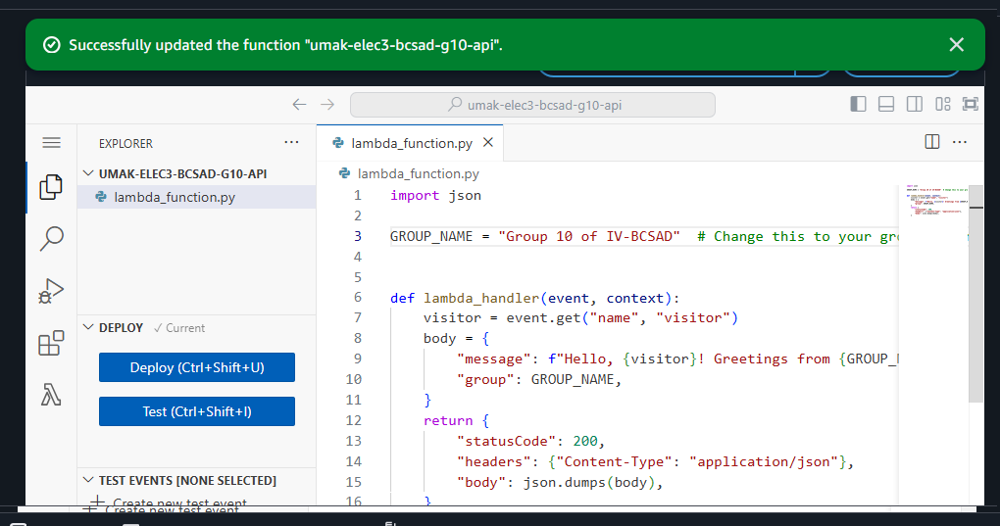
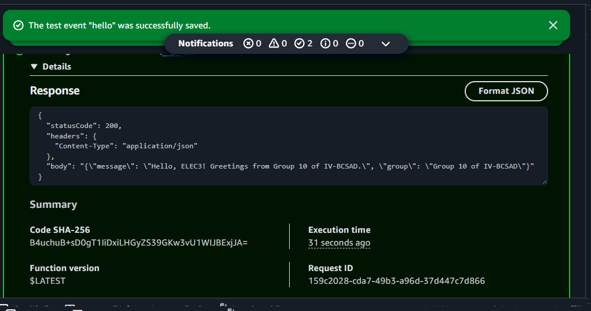
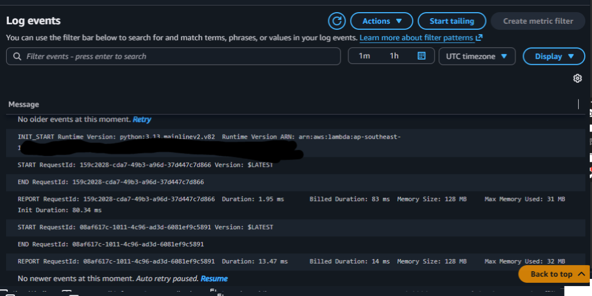

# Seatwork 4 Submission

<!--
How to use this template:

1. Copy this file to submissions/seatwork-4/group-<number>/submission.md
2. Replace every <answer> with your group's answer. Delete the angle brackets too.
3. Save code.png, test.png, and report.png in the same folder.
4. Crop the AWS console top bar out of all three screenshots, and cover every ARN.
5. Write GitHub usernames, not full names or student numbers.
-->

## About us

- Group number: 10
- Section: IV-BCSAD
- Group IAM user: bcsad-g10
- Function name: umak-elec3-bcsad-g10-api

## Handler code

```python
import json

GROUP_NAME = "Group 10 of IV-BCSAD"  # Change this to your group's name.


def lambda_handler(event, context):
    visitor = event.get("name", "visitor")
    body = {
        "message": f"Hello, {visitor}! Greetings from {GROUP_NAME}.",
        "group": GROUP_NAME,
    }
    return {
        "statusCode": 200,
        "headers": {"Content-Type": "application/json"},
        "body": json.dumps(body),
    }
```

## REPORT lines

First run, a cold start:

```text
REPORT RequestId: 159c2028-cda7-49b3-a96d-37d447c7d866	Duration: 1.95 ms	Billed Duration: 83 ms	Memory Size: 128 MB	Max Memory Used: 31 MB	Init Duration: 80.34 ms	
```

Second run, a warm start:

```text
REPORT RequestId: 08af617c-1011-4c96-ad3d-6081ef9c5891	Duration: 13.47 ms	Billed Duration: 14 ms	Memory Size: 128 MB	Max Memory Used: 32 MB	
```

## Question

Why does the second REPORT line have no Init Duration?

Because the function is already loaded in memory. The first time it runs, Lambda creates an execution environment, starts Python, and loads the code, which is called a cold start. The second time, Lambda reuses that existing environment, so it no longer needs to initialize everything again. It's like opening an app for the first time; the next time you open it, it's faster because it is already loaded in memory.

## Screenshots







## Contribution

| GitHub username | What this groupmate did |
| --- | --- |
| CANLASpogi | Step 1 |
| ambv13 | Step 2 |
| DrMacky | Step 3 |
| kopibean101223 | Step 4 |
